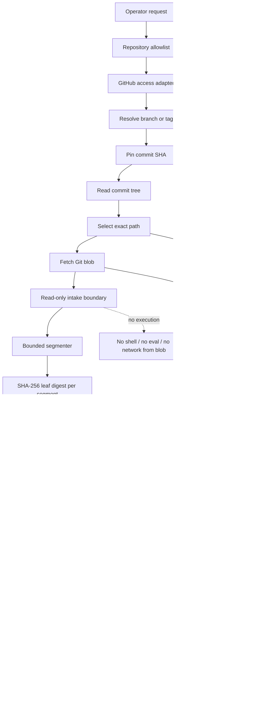

# Enblock Memory Diagram
## Git access through logic digest and segment hashing

**Status:** Architecture proposal / documentation only  
**Repository:** `SteelsSystem/MetaEye-Void`  
**Baseline ref:** `1.0aiRCHIVE`  
**Purpose:** Resolve a repository ref into immutable Git objects, inspect selected content through a bounded intake path, derive deterministic segment digests, and retain verifiable provenance without putting source content into the ledger.

> This document describes a proposed segment-integrity layer. It does not claim that segment hashing, a Merkle index, or an Enblock memory allocator is already implemented in this repository.

## 1. System boundary

Git access and local digest computation are separate trust domains.

- **Git access adapter:** authenticated GitHub connector/API. It resolves repository, ref, commit, tree and selected blob identifiers.
- **Intake boundary:** accepts only an explicitly selected repository, pinned commit and path. It does not execute repository content.
- **Segment hasher:** reads the raw blob bytes in fixed-size blocks and hashes each block.
- **Merkle reducer:** combines ordered segment digests into one content root.
- **Ledger:** stores metadata, digest values, policy decision and verification outcome; it does not store secrets or duplicate source contents.

## 2. Enblock block diagram



## 3. Identity layers — do not conflate hashes

| Layer | Identifier | What it identifies |
|---|---|---|
| Git ref | branch or tag name | A movable name; resolve it before relying on it |
| Git commit OID | commit object identifier | A commit and its parent/tree metadata |
| Git tree OID | tree object identifier | A directory snapshot |
| Git blob OID | blob object identifier | Git's blob object, including Git object framing |
| Whole-file SHA-256 | `file_sha256` | Raw file bytes |
| Segment SHA-256 | `segment_digest[i]` | One exact byte interval |
| Enblock Merkle root | `enblock_root` | Ordered segment set, total length and segment count |
| Provenance digest | `provenance_digest` | Canonical metadata binding the content root to its Git location |

Git object identifiers are not interchangeable with the raw-file SHA-256 or Enblock segment hashes. Git object hashing includes Git's object framing (for a blob, the `blob <length>\0` header) and uses the repository's object hash format. The baseline repository currently returns 40-hex-character Git object IDs; callers should still treat the OID as opaque rather than hard-code its length.

The existing `SHA256SUMS.manifest` is a whole-file checksum manifest. It is not a segment manifest and is not a Merkle tree.

## 4. Segment format and hash contract

Default proposal:

- Segment size: **65,536 bytes (64 KiB)**.
- Segment order: ascending zero-based index.
- Segment boundaries: byte offsets `i * segment_size`; do not normalize text, line endings or Unicode.
- Last segment: may be shorter than 65,536 bytes.
- Hash: SHA-256.
- Input: raw bytes returned for the pinned Git blob.
- Empty file: zero segments and a defined empty-tree marker.

For segment `i`, with byte length `len_i` and bytes `data_i`:

```text
leaf_i = SHA256(
    0x00 ||
    "ENBLOCK-SEG-v1\0" ||
    u64be(i) ||
    u32be(len_i) ||
    data_i
)
```

The prefixes are domain separators. The index and length bind the digest to its position and exact extent. Integers use unsigned big-endian encoding.

For each pair of child hashes:

```text
parent = SHA256(
    0x01 ||
    "ENBLOCK-NODE-v1\0" ||
    left_hash ||
    right_hash
)
```

At an odd-width level, promote the final unpaired hash unchanged to the next level. Do not duplicate it. The segment count and byte length are bound into the final root envelope:

```text
tree_root = reduce_merkle_tree(ordered_leaf_hashes)

enblock_root = SHA256(
    0x02 ||
    "ENBLOCK-ROOT-v1\0" ||
    u64be(total_byte_length) ||
    u32be(segment_count) ||
    tree_root
)
```

For an empty file:

```text
tree_root = SHA256("ENBLOCK-EMPTY-v1\0")
segment_count = 0
total_byte_length = 0
```

The same root envelope is then computed. An independent implementation must use exactly these framing, ordering, odd-node and empty-file rules to produce the same result.

A separate whole-file check is useful:

```text
file_sha256 = SHA256(raw_file_bytes)
```

It is an independent cross-check, not a replacement for the Merkle root.

## 5. Provenance envelope

The content root identifies bytes. The provenance envelope binds those bytes to the Git snapshot from which they were read.

Suggested canonical-CBOR fields:

| Field | Meaning |
|---|---|
| `schema` | `enblock.provenance.v1` |
| `repository` | Exact `owner/name` |
| `requested_ref` | User-requested branch or tag |
| `resolved_commit_oid` | Immutable commit OID resolved before reading |
| `tree_oid` | Tree OID containing the selected path |
| `path` | Exact repository-relative path |
| `git_blob_oid` | Git blob OID returned by Git |
| `git_oid_format` | Opaque repository object format identifier |
| `byte_length` | Exact raw byte length |
| `segment_size` | 65,536 by default |
| `segment_count` | Number of segments |
| `file_sha256` | Whole-file digest |
| `enblock_root` | Merkle root over ordered segments |
| `policy_version` | Intake and authorization policy version |

Compute:

```text
provenance_digest = SHA256(
    "ENBLOCK-PROVENANCE-v1\0" ||
    canonical_cbor(provenance_fields)
)
```

Do not include volatile fields such as wall-clock time in the deterministic content root. Timestamp, operator and connector request IDs may be recorded as separate audit metadata.

## 6. Bounded-memory processing

The target implementation should process a blob as a stream:

```text
pinned Git blob
      |
      v
read at most one 64 KiB segment
      |
      +--> hash (index, length, bytes)
      |
      +--> retain only leaf digest + length
      |
      v
discard/reuse segment buffer
      |
      v
reduce ordered digests
      |
      v
write provenance receipt
```

Memory target:

```text
payload_buffer <= 64 KiB
digest_working_set = O(segment_count) hashes
source_contents_retained_by_ledger = 0 bytes
```

The Merkle reduction can be implemented with an O(log n) frontier if the implementation supports streaming accumulation. A flat list of all leaf hashes is simpler but uses O(n) digest storage.

**Connector limitation:** the current GitHub connector's file/blob fetch actions return decoded file content as a response. This document's streaming memory bound applies to a future local byte-stream implementation; it is not a guarantee that the connector transport itself never materializes a whole response.

## 7. Access and execution policy

```text
ALLOW:
  resolve known repository
  pin commit
  enumerate tree metadata
  fetch explicitly selected blob
  hash raw bytes locally
  verify digest receipt

DENY:
  execute fetched code
  evaluate fetched content
  invoke shell with repository data
  follow arbitrary URLs from repository files
  fetch secrets or credential files into the ledger
  change a branch/ref as part of a read operation
  write to the default branch during intake
```

Unknown or unapproved paths should return `HOLD`, not an implicit allow. A digest proves byte identity relative to the selected input; it does not prove that the code is safe, benign, authored by a particular person, or approved for execution.

## 8. Verification sequence

1. Resolve the requested branch/tag exactly once and pin the returned commit OID.
2. Read the commit tree at that pinned commit.
3. Confirm the exact path exists in that tree and obtain its Git blob OID.
4. Fetch the blob and calculate byte length and whole-file SHA-256.
5. Re-segment the raw bytes using the fixed segment size.
6. Recompute every leaf hash and the Merkle root using the v1 rules above.
7. Recompute the provenance digest from canonical metadata.
8. Compare the result with a separately retained, trusted receipt or signed checkpoint.
9. Return `VERIFIED` only if all required comparisons pass; otherwise return `HOLD` or `REJECT`.

A hash chain or Merkle root alone does not authenticate the creator of a receipt. If authenticity is required, sign a checkpoint using a separately protected signing key and verify it against a trusted public key.

## 9. Receipt example

Illustrative schema only; values must be populated by an implementation:

```json
{
  "schema": "enblock.receipt.v1",
  "repository": "owner/repository",
  "resolved_commit_oid": "<git-commit-oid>",
  "path": "src/module.rs",
  "git_blob_oid": "<git-blob-oid>",
  "byte_length": 131072,
  "segment_size": 65536,
  "segment_count": 2,
  "file_sha256": "<64-hex>",
  "segment_digests": [
    "<64-hex>",
    "<64-hex>"
  ],
  "enblock_root": "<64-hex>",
  "provenance_digest": "<64-hex>",
  "verification": "PENDING"
}
```

## 10. Repository baseline observation

At the time this diagram was prepared, the inspected repository includes:

- `SHA256SUMS.manifest` — whole-file SHA-256 records.
- `scripts/verify_and_package.sh` — regenerates a whole-file manifest for selected project paths.
- Rust crate `needle-discord-metacog` — contains runtime, authentication, metacognition and telemetry code.
- No inspected file establishes an implemented Enblock segmenter or Merkle digest index.

This documentation is therefore a proposed extension and must not be cited as evidence that the implementation or its security guarantees already exist.
